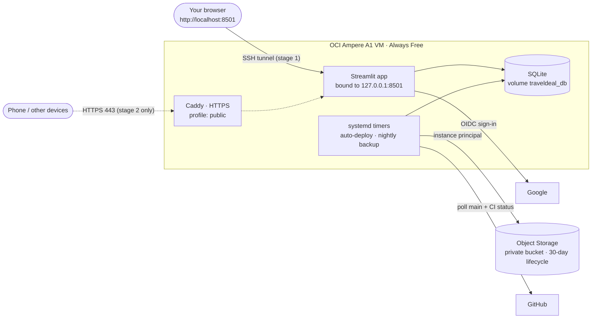

# Personal mode — backend design and setup

A deliberately small setup for **one person (plus a few invited people) testing TravelDeal Search** on Oracle Cloud Always Free. It is not built to scale. When it needs to, [SYSTEM_DESIGN.md](SYSTEM_DESIGN.md) describes the production design, and moving to it is a config change, not a rewrite (see §8).

| | Personal mode (this doc) | Production design |
|---|---|---|
| Who signs in | Google accounts on `ALLOWED_EMAILS` only | Anyone with Google; optional OCI Identity Domain |
| User data | SQLite file on the VM (Docker volume) | Autonomous Database |
| How you reach it | Stage 1: SSH tunnel to `localhost`. Stage 2: HTTPS on your domain | HTTPS on your domain |
| OCI services | 1 VM, 1 Object Storage bucket | VM, Autonomous Database, bucket, optional Identity Domain |
| Setup time | ~45 min for stage 1 | ~90 min |

## 1. Architecture



Dotted lines exist only in stage 2.

## 2. Login design

**Choice:** Google sign-in through Streamlit's built-in OpenID Connect (`st.login`), gated by an email allow-list.

1. You click **Continue with Google** on the Account page. Streamlit runs the authorization-code flow and sets a signed, HTTP-only cookie (signed with `cookie_secret`). The app never sees a password.
2. Each page run, `app/state.py` reads the verified identity. If `ALLOWED_EMAILS` is set and the email isn't on it (or Google says it's unverified), the visitor gets a "this server is private" screen with a sign-out button, and **nothing about them is written to the database.**
3. Allowed users get a `td_users` row keyed by `issuer|sub` (stable even if the email changes). Every read and write is scoped to that row's id.

Two independent gates keep strangers out: the **allow-list** in the app, and Google's own **Testing** publishing status, which lets only the test users you list complete sign-in.

**What's stored about a user:** Google subject id, email, display name, created and last-login times. No passwords, tokens or card numbers. Cards are catalog ids like `chase-sapphire-reserve`.

**Why not the alternatives:** rolling your own email/password means password hashing, reset emails and session handling, all for one user. The OCI Identity Domain works but is another console to configure; it stays available as an option in `secrets.toml.example`.

## 3. Data storage design

**Choice:** SQLite on a Docker volume on the VM, with nightly off-box backups.

- Same schema and code as production (SQLAlchemy). Tables: `td_users`, `td_wallet_cards`, `td_user_settings` (JSON: point valuation, cents-per-point overrides, credits used, elite status), `td_saved_comparisons` (JSON booking + best result), `td_schema_version`. Diagram in [SYSTEM_DESIGN.md §4](SYSTEM_DESIGN.md#4-data-model).
- Reference data (cards, loyalty programs, gift card snapshot) stays as JSON in the repo and ships in the image. Only what you create goes in the database.
- `DATABASE_URL=sqlite:////app/var/traveldeal.db` is set in `docker-compose.yml`. The file lives on the named volume `traveldeal_db`, so it survives rebuilds and redeploys.
- SQLite runs in **WAL mode** with a 5-second busy timeout, so the backup can read while the app writes. A handful of users is nowhere near SQLite's limits.

**Why SQLite instead of Autonomous Database for now:**

| | SQLite on the VM | Autonomous Database |
|---|---|---|
| Setup | Nothing | Create DB, run SQL, copy DSN, IP allow-list |
| VM's public IP changes | Nothing to update | DB access list must be updated |
| Inactivity | Nothing | Stopped after 7 days with no SQL; deleted after 90 days stopped |
| Local dev | Identical to the server | Different engine |
| Survives the VM being reclaimed | **No: restore from the nightly backup** | Yes |

The one real downside is the last row, and the nightly backup covers it.

**Backups:** `traveldeal-backup.timer` runs `python -m traveldeal.backup` nightly. It writes a gzipped JSON snapshot to the private bucket using the VM's instance principal (no API keys on disk), and a lifecycle rule keeps 30 days. **Worst case you lose up to one day of changes** (RPO 24 h); a rebuild takes about 30 minutes.

## 4. Free-tier usage

Limits from Oracle's [Always Free resources](https://docs.oracle.com/iaas/Content/FreeTier/freetier_topic-Always_Free_Resources.htm) page, checked Nov 2026.

| Resource | Always Free limit | Personal mode uses |
|---|---|---|
| Ampere A1 compute | 2 OCPU + 12 GB total (1,500 OCPU-h / 9,000 GB-h per month) | 1 VM. 1 OCPU / 6 GB is plenty; 2 / 12 is also free |
| Block volume | 200 GB total (boot + block), 5 volume backups | 50 GB boot volume |
| Object Storage | 20 GB, 50,000 requests/month (Always Free-only accounts) | A few KB a night, ~30 requests/month |
| Outbound data | 10 TB/month | Negligible |
| Load balancer, Vault, Autonomous DB, Identity Domain | — | Not used |

Set a **$1 budget alert** anyway. It is the tripwire for anything accidentally created outside Always Free.

## 5. Stage 1 — private, through an SSH tunnel (~45 min)

No domain, no certificate, no open web ports. You browse to `http://localhost:8501` on your laptop and the tunnel carries it to the VM. Google accepts plain-http `localhost` redirect URIs, so real sign-in works.

### 5.1 OCI console

1. **Guardrails:** note your **home region** (create everything there). **Billing & Cost Management → Budgets → Create budget**: `$1`, alert at 100% of actual spend.
2. **Compartment:** Identity & Security → Compartments → create `traveldeal`.
3. **Network:** Networking → Virtual cloud networks → **Start VCN Wizard → Create VCN with Internet Connectivity**, name `traveldeal-vcn`. In the public subnet's default security list, change the port-22 rule's source to **your IP** (`x.x.x.x/32`). **Don't** open 80/443 yet.
4. **VM:** Compute → Instances → Create instance `traveldeal-vm`: Ubuntu 24.04 (aarch64), shape **VM.Standard.A1.Flex** (1–2 OCPU, 6–12 GB, labeled *Always Free-eligible*), public subnet, assign a public IPv4, upload your SSH public key. Copy the **public IP** and **instance OCID**. If you get "Out of capacity", try another availability domain or later.
5. **Backup bucket:** Storage → Buckets → create `traveldeal-backups` (Standard, private). Add a lifecycle rule: delete objects older than 30 days.
6. **Let the VM write backups:** Identity & Security → Domains → Default → Dynamic groups → create `traveldeal-vm` with rule `instance.id = '<instance OCID>'`. Then Policies → create in `traveldeal`:
   ```
   Allow dynamic-group traveldeal-vm to manage objects in compartment traveldeal where target.bucket.name='traveldeal-backups'
   ```

### 5.2 Google sign-in client

1. https://console.cloud.google.com → new project `traveldeal`.
2. **Google Auth Platform** (formerly *OAuth consent screen*): app name, your email, audience **External**. Leave the publishing status on **Testing** and add your Gmail (and anyone else you'll invite) as **test users**. Scopes: `openid`, `email`, `profile`.
3. **Clients → Create client → Web application.** Authorized redirect URI: `http://localhost:8501/oauth2callback`. Copy the client ID and secret.

### 5.3 VM

```bash
ssh ubuntu@<VM public IP>
git clone https://github.com/vamsivoleti25/traveldeal_search.git /tmp/td
bash /tmp/td/deploy/setup_vm.sh          # Docker, app in /opt/traveldeal, deploy + backup timers
exit                                      # log back in so the docker group applies
ssh ubuntu@<VM public IP>
cd /opt/traveldeal
cp deploy/env.example deploy/.env && chmod 600 deploy/.env
cp .streamlit/secrets.toml.example .streamlit/secrets.toml && chmod 600 .streamlit/secrets.toml
python3 -c "import secrets; print(secrets.token_urlsafe(48))"   # → cookie_secret
nano deploy/.env                  # ALLOWED_EMAILS=your Gmail (comma-separate more); leave COMPOSE_PROFILES empty
nano .streamlit/secrets.toml      # cookie_secret, Google client_id + client_secret
deploy/compose.sh up -d --build   # first build takes a few minutes on Arm
deploy/compose.sh logs -f app     # Ctrl-C when you see "You can now view your Streamlit app"
```

### 5.4 Open it

On your laptop (stop any local `streamlit run` on port 8501 first):

```bash
ssh -N -L 8501:127.0.0.1:8501 ubuntu@<VM public IP>
```

Leave that running and open **http://localhost:8501**.

### 5.5 Check it works

1. **Account → Continue with Google.** You land back signed in.
2. Add three or four cards on **Compare**, one after another. Each should stick on the first click.
3. Change a setting and save a trip. Close the tab, reopen, and confirm everything is still there.
4. Try signing in with a Google account that isn't on `ALLOWED_EMAILS`: you should see the "private" screen.
5. Back up now and confirm a file appears in the bucket:
   ```bash
   sudo systemctl start traveldeal-backup.service && journalctl -u traveldeal-backup -n 20
   ```

## 6. Stage 2 — public HTTPS, for your phone (~15 min)

Do this when you want to use it away from your laptop.

1. **Hostname:** add a DNS **A record** pointing a subdomain you control (for example `traveldeal.vamsivoleti.com`) at the VM's public IP. No domain? `<ip-with-dashes>.sslip.io` works for the certificate; if Google rejects it as a redirect URI, use a real subdomain.
2. **Open the ports:** in the subnet's security list, add ingress TCP **80** and **443** from `0.0.0.0/0`. (`setup_vm.sh` already opened them in the VM's own firewall.)
3. **Google:** add `https://<your hostname>/oauth2callback` as a second authorized redirect URI.
4. **VM:**
   ```bash
   cd /opt/traveldeal
   nano deploy/.env                  # COMPOSE_PROFILES=public  and  DOMAIN=<your hostname>
   nano .streamlit/secrets.toml      # redirect_uri = "https://<your hostname>/oauth2callback"
   deploy/compose.sh up -d
   deploy/compose.sh logs -f caddy   # wait for "certificate obtained successfully"
   ```
5. Open `https://<your hostname>` and sign in. The allow-list still applies, so it is public but private.
6. Optional: in GitHub → Settings → Secrets and variables → Actions → Variables, set `SITE_URL` to enable the hourly uptime check.

To go back to private: set `COMPOSE_PROFILES=` and the localhost `redirect_uri`, then `deploy/compose.sh stop caddy && deploy/compose.sh up -d`.

## 7. Day to day

| Task | How |
|---|---|
| Ship a change | Push to `main`. Once CI is green, the VM deploys it within ~5 minutes (`traveldeal-update.timer`). |
| Logs | `deploy/compose.sh logs -f app` |
| Invite someone | Add their Gmail to `ALLOWED_EMAILS` (and as a Google test user), then `deploy/compose.sh up -d` |
| Back up now | `sudo systemctl start traveldeal-backup.service` |
| Copy of the data on your laptop | On the VM: `deploy/compose.sh run --rm -v /tmp:/out app python -m traveldeal.backup --local /out/snap.json.gz`. On your laptop: `scp ubuntu@<VM IP>:/tmp/snap.json.gz .` (or download from the bucket) |
| Restore onto a rebuilt VM | Download the newest `traveldeal/<date>.json.gz` from the bucket, `scp` it to the VM, then see [RUNBOOK.md](RUNBOOK.md) "Restore". The fresh volume is empty, which restore requires. |

## 8. Risks for a personal deployment

| Risk | What happens / what to do |
|---|---|
| **Idle VM reclamation.** Oracle may reclaim an Always Free VM whose CPU (95th percentile), network and memory all stay under 20% for 7 days. A personal app will usually be that idle. | You'd lose at most a day of changes; rebuild with §5.3 and restore the latest backup. Oracle's documented way out is upgrading the account to Pay As You Go (Always Free resources stay free). Don't run fake load to dodge the rule. |
| Your home IP changes | SSH (and the tunnel) stops working. Update the port-22 rule's source IP. |
| Google consent screen in Testing | Only listed test users can sign in, which is what you want here. |
| A1 "out of capacity" when creating the VM | Retry later or in another availability domain. |
| GitHub pauses scheduled workflows after 60 days of no activity | Re-enable them from the Actions tab. |

## 9. Growing out of personal mode

When you want data to outlive the VM, or open sign-up:

1. Create the Autonomous Database ([DEPLOY_OCI.md](DEPLOY_OCI.md) step 4).
2. Take a snapshot: `sudo systemctl start traveldeal-backup.service` (or `--local`).
3. Uncomment `ORACLE_*` in `deploy/.env`. The app prefers Oracle whenever those are set, so no code changes.
4. Restore the snapshot into the new database, then `deploy/compose.sh up -d`.
5. Clear `ALLOWED_EMAILS` only when you really want anyone to sign up.
