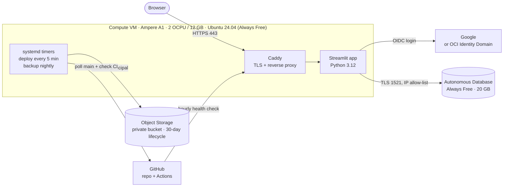
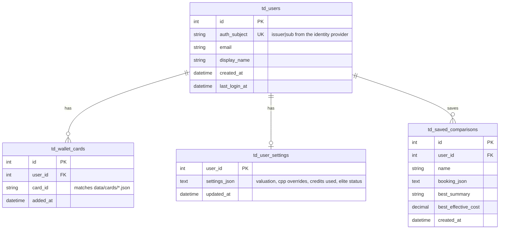

# TravelDeal Search — System design

A Python web product with real accounts and durable data, running entirely on
**Oracle Cloud Infrastructure (OCI) Always Free** resources for **$0/month**.

> For a single-person test setup (SQLite on the VM, invite-only Google sign-in, SSH tunnel), see
> [PERSONAL_SETUP.md](PERSONAL_SETUP.md). This document is the design to grow into.

## 1. Goals and constraints

| Requirement | How it's met |
|---|---|
| Real sign-in | OpenID Connect via Streamlit's built-in `st.login`: Google for anyone, plus optional invite-only email/password through a free OCI Identity Domain. The app never sees or stores passwords. |
| Data that survives restarts, redeploys and VM loss | User data lives in Autonomous Database (managed, separate from the VM) plus nightly off-box backups in Object Storage. Nothing important lives on the VM's disk. |
| $0 running cost | Only Always Free-eligible services, sized inside their limits, plus a $1 budget alert as a tripwire. |
| All Python | Streamlit UI, SQLAlchemy data layer, Python engine, Python ops scripts. |
| Safe releases | CI must pass before the VM deploys a commit; the VM pulls, so nothing needs inbound SSH from GitHub. |

## 2. Architecture



### Components and free-tier usage

| Component | OCI service | Always Free limit | This design uses |
|---|---|---|---|
| App server | Compute, `VM.Standard.A1.Flex` | 2 OCPU + 12 GB total (1,500 OCPU-h / 9,000 GB-h per month) | 1 VM, 2 OCPU / 12 GB |
| Disk | Block Volume (boot) | 200 GB total | 50 GB boot volume |
| Database | Autonomous Database, Transaction Processing | 2 DBs, 1 OCPU, 20 GB, 20 simultaneous sessions each | 1 DB, connection pool of 6 |
| Backups | Object Storage | 20 GB (after trial), 50,000 requests/month | ~30 small files, ~30 requests/month |
| Network | VCN + public subnet, security list | 2 VCNs | 1 VCN |
| Egress | Outbound data transfer | 10 TB/month | Well under 1 GB/month at hobby scale |
| Login (optional) | IAM Identity Domain, Free type | 2,000 users, 2 non-Oracle apps, no self-registration | 1 app |
| Login (default) | Google OAuth | Free | 1 OAuth client |
| HTTPS certificate | Let's Encrypt via Caddy | Free | 1 certificate |
| Monitoring | GitHub Actions scheduled workflow | Free for public repos | 1 hourly check |

Load balancers, Vault, Email Delivery and paid Identity Domain types are deliberately **not** required.

## 3. Request and login flow

1. The browser connects to `https://DOMAIN`. Caddy terminates TLS with a free Let's Encrypt certificate and proxies HTTP and WebSocket traffic to the Streamlit container.
2. Anonymous visitors can use everything except saving. Their wallet is kept in the URL (`?cards=...`), so it survives a refresh and can be bookmarked.
3. **Sign in** calls `st.login("google")` or `st.login("oci")`. Streamlit runs the OpenID Connect authorization-code flow and sets a signed, HTTP-only identity cookie (`cookie_secret`).
4. On each run, `app/state.py` reads the verified identity (`iss` + `sub` claims) and upserts a row in `td_users`. The internal user id never comes from the browser.
5. On first sign-in, cards picked while anonymous are merged into the saved wallet.
6. Every repository call is scoped by that user id (`WHERE user_id = :me`), so users can't read or change each other's rows; tests cover this.

## 4. Data model



- **Reference data** (97 cards, currencies, loyalty programs, gift card snapshot) stays as versioned JSON in the repo, reviewed through pull requests, and ships inside the container image. Only user-generated data goes in the database.
- One SQLAlchemy schema runs on Oracle (production) and SQLite (local and tests). Table names avoid Oracle reserved words, every string has a length, and JSON is stored as text for portability.
- Tables are created on startup (`init_db`) and a `td_schema_version` row records the version. Alembic migrations are the next step once the schema starts changing.
- Per-user caps: 60 wallet cards, 200 saved comparisons.

## 5. Durability, backups and recovery

| Risk | Mitigation |
|---|---|
| VM disk lost or VM reclaimed | No user data on the VM. Rebuild the VM from the repo in about 30 minutes; data is untouched in Autonomous Database. |
| Always Free database has **no backup or restore** | `traveldeal-backup.timer` runs `python -m traveldeal.backup` nightly. It writes a gzipped JSON snapshot of every table to a private bucket. A lifecycle rule keeps 30 days. |
| Database stopped after **7 days** without SQL activity, reclaimed after **90 days** stopped | The nightly backup runs real SQL, which resets the inactivity clock every day. |
| Bad deploy | CI must pass first; `git reset --hard <previous-sha>` plus `docker compose up -d --build` rolls back in minutes. |

**Targets:** RPO 24 hours (one nightly snapshot), RTO about 1 hour. `python -m traveldeal.backup --restore FILE` loads a snapshot into an empty database and moves Oracle identity sequences past the restored ids. See [RUNBOOK.md](RUNBOOK.md).

## 6. Security

- **No passwords stored.** Google or the OCI Identity Domain handles credentials, password reset and MFA.
- **Secrets on the VM only:** `deploy/.env` and `.streamlit/secrets.toml`, both `chmod 600`, both git-ignored. A later step can move them to OCI Vault (150 free secrets).
- **Database:** walletless TLS, an access-control list allowing only the VM's public IP, and a least-privilege `TRAVELDEAL` schema user. The app never connects as `ADMIN`.
- **Backups:** written with the VM's **instance principal**, so there are no API keys on disk. The policy limits writes to one bucket.
- **Network:** the security list allows 80 and 443 from anywhere and 22 only from your IP. Host iptables mirror that. Caddy adds HSTS and other security headers.
- **Container:** runs as a non-root user with a memory limit, a health check and an automatic restart.
- **Privacy:** users can download all their data and permanently delete their account from the Account page.

## 7. Delivery pipeline

```
push to main ──> GitHub Actions CI (validate data, 45 tests, Arm docker build)
                       │ all checks green
                       ▼
VM: traveldeal-update.timer (every 5 min) ── sees new commit + green checks ──> git reset + docker compose up -d --build
```

Pull-based deploys mean GitHub never needs SSH access to the VM.

## 8. Monitoring

- **Docker health check** on `/_stcore/health` with `restart: unless-stopped`.
- **Uptime workflow** (`.github/workflows/uptime.yml`) checks the public URL hourly and opens an `outage` issue when it fails.
- **Card data health workflow** opens an issue monthly when rotating categories expire or cards go unverified.
- Logs: `docker compose logs -f app` (rotated, 3 × 10 MB).

## 9. Free-tier risks to know about

| Risk | What to do |
|---|---|
| **Idle VM reclamation:** Oracle may reclaim an Always Free VM whose 95th-percentile CPU, network and memory all stay under 20% for 7 days, which a quiet hobby app will hit. | The design already survives it: no data lives on the VM, and the RUNBOOK rebuilds it in about 30 minutes. To avoid it, the commonly recommended route is upgrading to **Pay As You Go**. Oracle states Always Free resources stay free after upgrading and you're charged only above the free limits, but confirm in Oracle's Free Tier FAQ that reclamation doesn't apply to your account type. Pair it with the $1 budget alert. Don't run fake load to dodge the rule. |
| A1 capacity shortages ("out of capacity") when creating the VM | Retry later or in another availability domain of your home region. |
| Trial end: A1 instances over 2 OCPU / 12 GB in total are disabled, then deleted | This design stays at exactly 2 OCPU / 12 GB. |
| Trial end: Object Storage over 20 GB has its objects deleted | Backups are kilobytes; the lifecycle rule keeps 30 days. |
| GitHub pauses scheduled workflows after 60 days with no repository activity | Re-enable from the Actions tab, or commit occasionally. |
| Always Free database is limited to 20 simultaneous sessions | The connection pool is capped at 6. |

**Cost guardrails:** create everything in your home region, pick only shapes labeled *Always Free-eligible*, and set a budget with an alert at $1 so any accidental paid resource emails you within a day.

## 10. Capacity and scaling path

- 2 OCPU / 12 GB comfortably serves dozens of concurrent Streamlit sessions; the comparison engine is pure Python and runs in milliseconds.
- The database holds a few KB per user, so 20 GB is effectively unlimited for this product.
- **When it outgrows the free tier:** add a second A1 VM behind the free flexible load balancer (sessions are sticky via the Streamlit cookie), move secrets to Vault, add Alembic migrations, and move to a paid Autonomous Database for built-in point-in-time recovery.

## 11. Alternatives considered

| Option | Why not (for now) |
|---|---|
| PostgreSQL in Docker on the VM | Simpler SQL, but data would live on the VM that Oracle may reclaim. Autonomous Database keeps data off the VM and is managed. |
| Rolling our own email/password login | Needs password hashing, reset emails and session cookies, which Streamlit can't set natively. OIDC is safer and less code. |
| OCI Identity Domain as the only login | The free domain type has no self-registration, so strangers couldn't sign up. It works well as an invite-only second option. |
| FastAPI + React | More typical for a large product, but roughly twice the code; Streamlit keeps the whole stack in Python. |
| Streamlit Community Cloud | Free and simpler, but no durable storage of its own and apps sleep. OCI gives a real database and an always-on server. |
